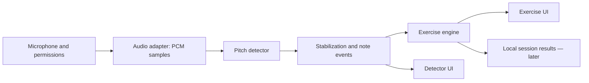

# Proposed architecture

Status: logical design; no modules have been implemented yet.

## Responsibilities

- Audio adapter: start/stop, permissions, actual sample rate, channels, timestamps, session interruptions, and microphone release.
- Detector: mono PCM frame → frequency or no reliable result; independent of the UI. Compare algorithms in the experiment.
- Music logic: Hz → MIDI number, note name, octave, and deviation in cents; later, tunings and fretboard mapping.
- Stabilization: level threshold, algorithm confidence measure, and reduced reading fluctuations. Include smoothing in the latency budget.
- Exercise engine: target, tolerance, hold duration, and step transitions. Repeated notes require separate onset detection; continuous pitch alone is insufficient.
- UI: state presentation and session controls. No DSP calculations in view components.

## Draft contracts

AudioFrame: samples (mono Float32Array), sampleRateHz, capturedAtMs (monotonic clock).

PitchEstimate: frequencyHz or null, confidence (an algorithm-specific measure, not a probability), rms, capturedAtMs.

NoteObservation: midiNote or null, cents or null, stable, capturedAtMs. Missing input must not leave an old note displayed as a current measurement.

These formats are proposals. Before parallel implementation, agree on a shared contract, units, and buffer ownership. The UI may refresh less frequently than audio analysis.

## Platforms and privacy

First, evaluate the web audio pipeline on target devices. Web Audio with AudioWorklet is a candidate for web; microphone access requires permission and a secure context. A native version may require a platform-specific audio adapter.

Samples remain in device memory. No recording files, audio uploads, or backend by default. Test recordings require deliberate preparation and documented provenance.

Sources: [AudioWorklet](https://developer.mozilla.org/en-US/docs/Web/API/AudioWorklet), [getUserMedia](https://developer.mozilla.org/en-US/docs/Web/API/MediaDevices/getUserMedia).
