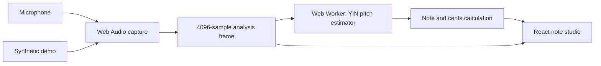

# Desktop architecture

Updated: 2026-10-10. Implemented initial browser version.

## Responsibilities

- src/audio/useDesktopAudio.ts owns permission requests, device enumeration, AudioContext and stream lifecycle, input waveform/level, and communication with the worker.
- src/audio/pitch.worker.ts runs pitch estimation away from the UI thread. Only one analysis request is outstanding at a time.
- src/audio/pitch.ts contains framework-independent YIN-style estimation and musical conversions. It rejects low-level, invalid, or insufficiently periodic input.
- src/App.tsx displays the detector, input controls, standard string reference, and clearly labeled demo. src/styles.css provides desktop and narrow-screen layouts.
- src/audio/level.ts is a retained framework-independent RMS utility, covered by tests.

No exercise engine or persistence exists yet. Generated Android/Expo build directories are inactive and ignored. package.json and its lockfile contain the desktop dependencies only.

## Audio details

Request mono input with echo cancellation, noise suppression, and automatic gain disabled; browsers may choose different actual settings. Use the AudioContext sample rate for analysis. The analyser frame is 4096 samples, dispatched at approximately 65 ms intervals. UI waveform data is reduced for display. A muted output connection maintains graph processing without microphone monitoring.

The worker uses a difference function, cumulative mean normalization, threshold selection, and parabolic interpolation. The initial implementation does not include temporal median smoothing or attack detection. Silence clears the live note. The displayed analysis time measures worker computation only, not microphone or display latency.

Session generations prevent late permission responses from reviving canceled sessions. Stop releases tracks, worker, graph, and AudioContext. Hidden tabs stop automatically. A disconnected track and worker errors report actionable UI messages. Synthetic demo tones use the same analyser/worker path as microphone input, but do not validate real microphone behavior.

Sources: [Web Audio](https://developer.mozilla.org/en-US/docs/Web/API/Web_Audio_API), [getUserMedia](https://developer.mozilla.org/en-US/docs/Web/API/MediaDevices/getUserMedia), [YIN paper](https://pubmed.ncbi.nlm.nih.gov/12002874/).
