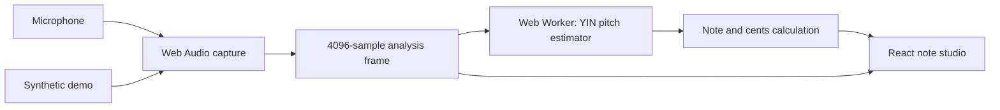

# Desktop architecture

Updated: 2026-10-11. Desktop browser with Settings and local preferences.

## Responsibilities

- src/audio/useDesktopAudio.ts owns permission requests, device enumeration, AudioContext and stream lifecycle, input waveform/level, and communication with the worker.
- src/audio/pitch.worker.ts runs pitch estimation away from the UI thread. Only one analysis request is outstanding at a time.
- src/audio/pitch.ts contains framework-independent YIN-style estimation and musical conversions. It rejects low-level, invalid, or insufficiently periodic input.
- src/App.tsx owns screen navigation and the shared audio hook, displaying the detector, standard string reference, and clearly labeled demo. src/styles.css provides desktop and narrow-screen layouts.
- src/audio/level.ts is a retained framework-independent RMS utility, covered by tests.

src/Settings.tsx owns settings UI, validated versioned localStorage preferences, and theme token generation. App passes audio state/actions into Settings so screen navigation does not remount capture. CSS custom properties apply the chosen accent and hue-derived surfaces across both screens. Preferences and best-score summaries persist; no audio or per-note exercise history is stored. Note Practice uses the separate pure state machine described below. Generated Android/Expo build directories are inactive and ignored. package.json and its lockfile contain the desktop dependencies only.

## Audio details

Request mono input with echo cancellation, noise suppression, and automatic gain disabled; browsers may choose different actual settings. Use the AudioContext sample rate for analysis. The analyser frame is 4096 samples, dispatched at approximately 65 ms intervals. UI waveform data is reduced for display. A muted output connection maintains graph processing without microphone monitoring.

The worker uses a difference function, cumulative mean normalization, threshold selection, and parabolic interpolation. The initial implementation does not include temporal median smoothing or attack detection. Silence clears the live note. The displayed analysis time measures worker computation only, not microphone or display latency.

Session generations prevent late permission responses from reviving canceled sessions. Stop releases tracks, worker, graph, and AudioContext. Hidden tabs stop automatically. A disconnected track and worker errors report actionable UI messages. Synthetic demo tones use the same analyser/worker path as microphone input, but do not validate real microphone behavior.

Sources: [Web Audio](https://developer.mozilla.org/en-US/docs/Web/API/Web_Audio_API), [getUserMedia](https://developer.mozilla.org/en-US/docs/Web/API/MediaDevices/getUserMedia), [YIN paper](https://pubmed.ncbi.nlm.nih.gov/12002874/).

## Profile and tuning modules

src/Profile.tsx owns nickname validation, cookie read/write, and onboarding/edit forms. React renders nicknames as text. The profile is a single local identity, independent of audio and saved preferences. src/audio/tunings.ts defines six tuning presets as MIDI arrays ordered low to high; App derives names/frequencies through the pure pitch utilities and matches detected MIDI to each target. Demo selection uses a string index so changing tuning updates its generated note. The detector accepts 65–1350 Hz with a lag search down to 60 Hz to accommodate low D2.

## Practice boundaries

- src/practice/engine.ts is a UI/platform-independent state machine for countdown, response, score, and completion, driven by caller-supplied timestamps and MIDI detections.
- src/practice/NotePractice.tsx owns setup, timers, microphone lifecycle, and results. Its dedicated audio hook is cleaned up on leaving the screen; entering practice stops the studio session. A preview exercises timing without audio or score writes.
- src/practice/scores.ts reads/writes a bounded, validated high-score cookie keyed by exercise configuration. Practice configuration uses a separate versioned localStorage key.
- Audio capture exposes the estimated oldest-sample timestamp of each analyzed frame, allowing practice to reject pre-target frames and late results. This is timing bookkeeping, not measured acoustic latency.

Practice tuning and selected MIDI pitches persist in guitartrainer.practice.notes.v1, independently from studio preferences. Sequence generation supports one or more selected pitches; score keys add a sorted pitch-class-set suffix for subsets with an any-octave scoring namespace.

Practice engine normalizes MIDI values modulo 12 for matching and sequence deduplication. UI groups tuning pitches by pitch class; storage can retain MIDI representatives from earlier selections. Studio pitch reporting remains unchanged.

ScalePractice.tsx owns independent scale configuration, audio lifecycle, and the two-mode UI. Random mode reuses the pure practice engine and score-cookie module. scales.ts defines interval sets, transposition, and a pure ordered-run state machine accepting capture timestamps, with release gating at identical-note repetition boundaries.

GitHub Pages deployment uses a dedicated Actions build with /GuitarTrainer/ as Vite base so scripts and the audio worker load under the project path. Only dist is uploaded. Deployment needs Pages write and OIDC permissions; build has read-only repository access. Local development retains its root base.

## Spider Walk modules

src/practice/spider.ts defines validated setup, pure finger/string/fret sequence generation and beat-to-position calculation. src/practice/SpiderPractice.tsx owns setup persistence, guide UI, and session lifecycle. src/audio/metronome.ts schedules short oscillator clicks against AudioContext time with a 100 ms lookahead and 25 ms scheduling interval. The UI samples the same clock; it does not drive audio scheduling. A silent AudioContext supplies the clock when clicks are disabled. Stop/unmount/hidden-tab cleanup closes the context and clears scheduling; an asynchronous start cannot revive a canceled session. This is scheduling design, not a measured latency guarantee.

### Scored routines

spiderPatterns.ts provides pattern validation/presets; PatternCreator.tsx and RoutineEditor.tsx own the library and ordered block editor. spiderRoutine.ts validates/migrates configuration, expands blocks/per-string patterns into exact fret targets, and implements pure timestamp-based scoring. spider.ts remains the v1 migration schema and beat-position helper.

SpiderPractice.tsx owns a dedicated useDesktopAudio session, a Metronome, and session score state. It resumes the clock in the start gesture, waits for microphone readiness, then starts count-in. Metronome exposes its origin in performance.now coordinates so capture timestamps and beat windows can be compared. Scoring rejects old or late analysis rather than crediting a later target. The music module has no UI/browser dependency; persistence and capture lifecycle stay at the UI boundary. ADR 0008 supersedes ADR 0007's no-scoring decision.

## Backup boundary

src/backup.ts owns the versioned JSON contract, allowlisted storage/cookie keys, domain validation, export collection and verified restore with rollback through an injected storage adapter. It reuses pure practice validators and does not enumerate unrelated browser storage. src/BackupSettings.tsx owns local file selection/download, replacement review and post-import reload. The App supplies current appearance/audio preferences and nickname so those can be exported even before persistence. Note/Scale setup persists on each valid edit to ensure navigation to Settings preserves the current configuration.

## Untimed practice and localization

FreePractice.tsx owns untimed note/scale capture and setup, reusing the pure ordered-run engine in scales.ts for pitch-class matching and repeated-note release gating. freeSetup.ts validates its independent configuration. Distinct React keys ensure changing between note and scale screens cancels capture and resets runtime state. Manual Spider Walk traverses four-note groups from the existing pure expanded routine without starting an audio clock.

MetronomePractice.tsx uses the existing audio-clock scheduler with configurable accent grouping and indefinite playback. optionsSchema.ts defines language, mode and metronome settings; options.ts exposes a subscribed local store with write-failure reporting. i18n.tsx/translation.ts with polish.ts and spanish.ts translate explicit render-time keys without DOM mutation or changes to musical data. App subscribes to language/options changes; document.lang updates alongside rendered text. Backups validate new optional options/untimed sections and pad missing older sections with null before restore.

ModeSwitch.tsx provides the shared presentational mode selector using native radio inputs. Parents map its boolean selection onto their existing saved timed/free or timed/manual values; exercise logic is unchanged.

PracticeHeader.tsx owns the persistent Note/Scale heading, mode selection and mode-specific guide outside the exercise components. Switching modes replaces only the exercise body, preserving header and guide state while keeping the existing exercise unmount cleanup.

MicrophoneCheck.tsx orchestrates the guided Settings check through the shared useDesktopAudio capture session, without duplicating capture or DSP. setupCheck.ts is a pure assessment function over numeric level/MIDI samples, tested independently from the UI. The component owns cancellation of sessions it starts, and keeps measurement buffers only in memory.

TempoPresets.tsx owns long-press saving and short-press recall controls. The optional tempoPresets options field validates exactly four bounded integer values; missing legacy values use defaults. MetronomePractice owns stopping/restarting playback on recall.

feedback.ts aggregates immutable completed-session data; SessionFeedback.tsx renders it. Timed Round stores accepted indices and response durations without changing scoring criteria. walkTiming.ts computes variable beat offsets and positions from routine repetition boundaries. Metronome accepts optional explicit beat offsets; Spider Walk uses the same offsets for capture-window scoring and visual position. WalkSetup has an optional validated ladder configuration so old backups remain valid.

MetronomeVolume.tsx shares the options-backed volume control across Settings and Metronome. The scheduler routes click envelopes through one output GainNode, preserving timing and accent envelopes while scaling or muting output. Options validation accepts the absent legacy field or integer percentages from 0 to 100.

NoteSelector shares controls between Timed and Free Note Practice. noteSelection validates and migrates legacy tuning-based selections independently of UI; backups use the same reader. Free setup retains its legacy tuning field only for compatibility.

Spider Walk rework: spiderLibrary.ts owns pure position validation, expansion, legacy migration and portable JSON. SpiderCreator/SpiderFretboard edit records; SpiderFiles handles file review and additive imports. SpiderPractice orchestrates audio lifecycle and the optional independent Metronome. spiderRun.ts advances exact-pitch targets from fresh capture frames, gates identical targets on release and records start/completion timestamps. The library uses guitartrainer.spider.library.v1; backups accept a missing legacy section. Old scorer/timing modules remain for legacy tests/data, but the active screen no longer uses them. See ADR 0012, superseding earlier beat-scoring and manual-mode decisions for Spider Walk.

Spider Walk optional BPM progression derives tempo from the current full-pattern repetition. Metronome.setTempo updates future click spacing without replacing its AudioContext; explicit legacy beat schedules remain supported. SpiderFiles uses a native modal dialog for export selection and focus containment.
